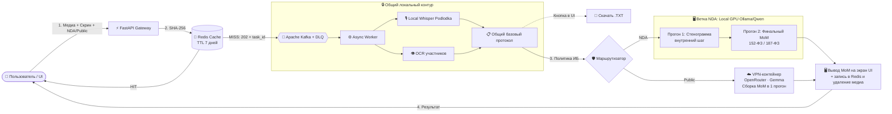

# AI MoM Enterprise Pipeline

Двухконтурная асинхронная система автоматического протоколирования встреч (MoM) с поддержкой локального **NDA** и облачного **Public** контуров.

## Архитектура решения

- **Вход:** Веб-форма / Телефон (HTTPS через Nginx + Let's Encrypt + Fail2ban)
- **Прием задач:** FastAPI Producer -> Redis (статусы и кеш ASR по SHA-256)
- **Очередь:** Apache Kafka (KRaft + DLQ)
- **Обработка:** Direct Python Worker (`app/worker.py`) с локальным GPU-конвейером (CTranslate2/faster-whisper для транскрибации и очистки VRAM, Ollama VLM `qwen2.5vl:7b` для анализа скриншотов ВКС, Ollama `qwen3.6:35b` для формирования MoM)
- **Маршрутизация LLM:** Локальная модель в контуре NDA или облачная через внешний HTTP-прокси (`OPENROUTER_PROXY_URL`) в контуре Public.

## Ключевые возможности и безопасность

- **Прямой GPU-инференс:** работа без GUI-прослоек с выгрузкой весов из VRAM.
- **Двухконтурность (NDA / Public):** локальный инференс или безопасный проход через внешний HTTP-прокси.
- **Отказоустойчивость:** разделение приема и тяжелых задач через Kafka, дедупликация через Redis SHA-256.
- **DevSecOps:** защита от timing-атак, валидация путей, Bandit SAST и pre-commit хуки.

## Оптимизации Спринта 2

- **Кеширование ASR:** повторные задачи с тем же SHA-256 не пересчитываются (TTL 7 суток), `force_recompute` обходит кеш.
- **Очистка VRAM:** `free_vram()` после каждого инференса, ленивая загрузка WhisperModel с кэшированием между задачами.
- **Ручной commit Kafka:** `max.poll.interval.ms` 30 мин, ретраи до 3, фатальные ошибки сразу в DLQ.
- **Ротация free-моделей:** Public-контур через OpenAI SDK → OpenRouter с ротацией бесплатных моделей.

## Быстрый запуск

1. `cp .env.example .env`
2. `docker compose up -d`
3. `uvicorn app.producer:app --host 127.0.0.1 --port 8000` и `python -m app.worker`

© 2026 Сироткин Станислав
